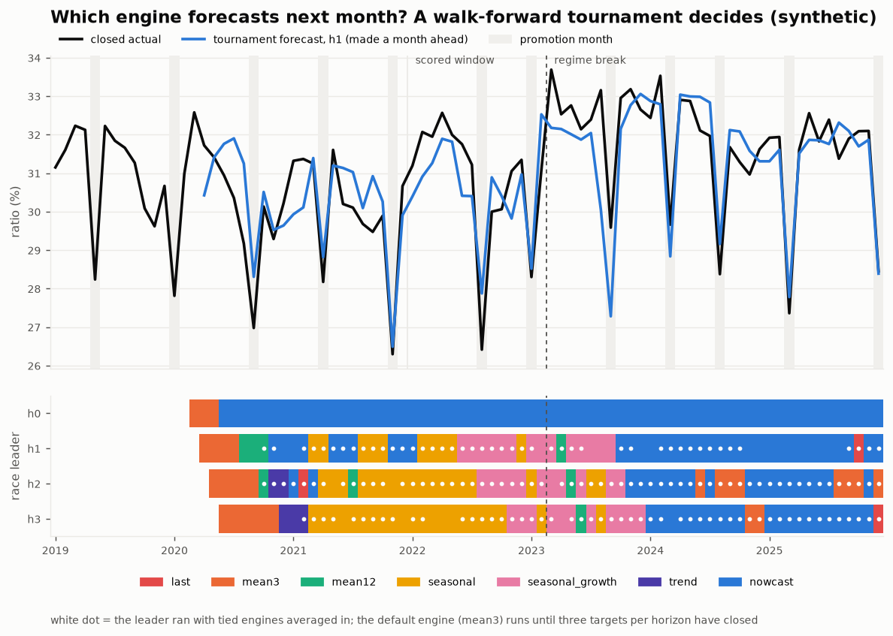
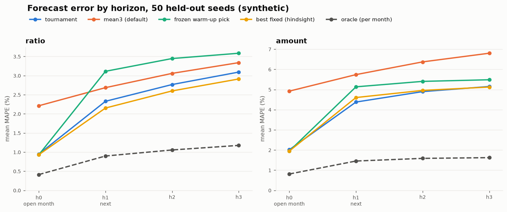

# Forecast Tournament

[](https://github.com/cloudavenue0012-creator/forecast-tournament/actions/workflows/ci.yml)


Every month a finance team has to put a number on months that haven't closed yet —
the month whose books are still open, next month, the quarter after. *Which method
produces that number* is usually a person's habit ("use the 3-month average"). This
repo replaces the habit with a **walk-forward tournament**: eight forecasting engines
forecast every horizon every month, each is scored the moment its target month
closes, and the recent scoreboard — not a person — decides which engine(s) forecast
the next decision. Each horizon is its own race.

> **100% synthetic data.** The monthly series, the daily rows under them, the
> promotion calendar, the regime break and the close adjustments are all generated
> from a seed (`synth_series.py`). No company data, names, figures or systems.
> A portable re-implementation of a forecasting pattern used in FP&A.



*Top: the closed series (ratio metric, seed 42), promotion months shaded, and the
next-month forecast the tournament actually used. Bottom: which engine led each
horizon's race, month by month. The open-month race (h0) locks onto the nowcast;
the longer races keep changing hands — and reshuffle after the regime break.*

## Why this exists

A fixed forecasting method fails quietly. A 3-month average is fine until a
promotion month drops into its window; same-month-last-year is fine until the
business changes shape and last year stops being a guide. Nobody notices, because
nobody scores the method — the forecast gets replaced by the actual and the miss
is forgotten.

The tournament makes the scoring the system: every forecast is kept, scored against
the booked actual when its month closes, and the scoreboard is what selects. In the
production setting this generalises, the race settled on a **month-to-date nowcast
for the still-open month and a short rolling average beyond it**, and a scorecard
arrives by e-mail at every close. This repo rebuilds that loop on synthetic data and
— the point — measures whether it is actually better than the habit it replaces.

## Design

**Synthetic world** (`synth_series.py`). 84 months of daily rows rolled up into two
metrics: a margin-style **ratio** (additive) and a monthly **amount** in KRW
(multiplicative). Planted ground truth: drift and growth, a yearly season, **one-off
promotion months** (planned, so the calendar is known in advance; on promotion days
the amount jumps and the ratio drops), a **regime break** in month 50 (level steps,
and the seasonal cycle flattens for good), AR(1) month noise, day noise, and a
**month-end close adjustment** — so a month's day-15 figure is never its booked value.

**Timeline.** The decision is taken on day 15 of month *t*. Months before *t* are
closed; month *t* is open and only its days 1–15 are visible. Horizons:

| race | target | in practice |
|---|---|---|
| h0 | the open month *t* | "last month" in a close calendar — ended, books not closed |
| h1 | *t*+1 | next month |
| h2, h3 | *t*+2, *t*+3 | the rest of the quarter |

**Engines** (`engines.py`) — each is a pure function of an `Info` object that holds
only what is knowable on decision day, and each returns the closed months it read:

| engine | what it does |
|---|---|
| `last` | previous closed month |
| `mean3` / `mean12` | 3- / 12-month rolling average (`mean3` is the "default" a person would pick) |
| `seasonal` | same month last year |
| `seasonal_growth` | same month last year × the year-on-year change of the latest 3 month pairs |
| `ses` | simple exponential smoothing |
| `trend` | linear regression on the last 12 months, extrapolated |
| `nowcast` | h0: the open month's day-15 figure (promotion days removed), corrected by the day-15 → close gap learned from closed months. h≥1: a 3-month average whose newest point is that nowcast |

Promotion months are planned, so their effect is handled by one **shared overlay**
learned only from closed promotion months and applied identically to every engine —
it cannot tilt the race. Rolling windows skip promotion months (event masking).

**Selection** (`tournament.py`). Per horizon, a recency-weighted MAPE (half-life 6)
over the latest 24 scored targets ranks the engines. The leader runs, joined by any
engine within 20% of it (at most three), and their forecasts are averaged. When one
engine is clearly ahead — the nowcast at h0 — it runs alone; when several are
statistically tied, averaging them beats betting on whichever got lucky last month.
The rule was **chosen on tuning seeds 100–119 only**; every number below comes from
seed 42 and held-out seeds 0–49.

**Gates.** Every forecast carries its provenance, and two gates audit it:
the *final-history gate* (no engine reads, and no score is computed against, a value
that is not a closed booking) and the *event-window gate* (no engine reads a
promotion month as baseline history). In strict mode a violation raises.

## Results (`eval.py`, seed 42, 48 scored months straddling the break)

MAPE by horizon. *Frozen pick* = the engine that looked best on the warm-up months,
kept forever (what a careful analyst does once, by hand). *Best fixed* = the single
best engine chosen **with hindsight** — not available live. *Oracle* = the best engine
for each month after the fact. *Gap closed* = share of the mean3 → oracle gap removed.

| metric / horizon | tournament | mean3 | frozen pick | best fixed (hindsight) | oracle | gap closed |
|---|---:|---:|---:|---:|---:|---:|
| ratio h0 (open month) | **0.75%** | 2.02% | nowcast 0.75% | nowcast 0.75% | 0.37% | 77% |
| ratio h1 | **2.23%** | 2.40% | nowcast 1.86% | nowcast 1.86% | 0.66% | 10% |
| ratio h2 | **2.29%** | 2.56% | seasonal 3.34% | nowcast 2.29% | 0.78% | 15% |
| ratio h3 | **2.35%** | 2.81% | seasonal 3.34% | nowcast 2.52% | 0.78% | 22% |
| amount h0 (open month) | **1.68%** | 4.83% | nowcast 1.68% | nowcast 1.68% | 0.73% | 77% |
| amount h1 | **4.40%** | 5.79% | seasonal 6.98% | nowcast 4.97% | 1.68% | 34% |
| amount h2 | **5.39%** | 6.42% | seasonal 6.98% | mean12 5.55% | 1.86% | 23% |
| amount h3 | **5.71%** | 6.84% | seasonal 6.98% | mean12 5.72% | 1.87% | 23% |

On 50 held-out seeds (400 seed × metric × horizon cells) the tournament:

- **beats the default engine (mean3) in 94.5%** of cells (100% on every amount race and both h0 races);
- matches or beats the frozen warm-up pick in 75.5%;
- matches or beats the hindsight-best fixed engine in 43.2%, with a **median regret of +1.1%**;
- closes on average 35% of the gap between the default and the per-month oracle (70% at h0).



### Where it loses — the price of a tournament

The tournament does **not** reliably beat the best fixed engine chosen in hindsight:
on seed 42 it is behind it in one cell (ratio h1, 2.23% vs 1.86%, regret +19.6%), and
across held-out seeds it wins only 12% of ratio-h1 cells. Splitting h1 error by period
around the regime break shows where the loss comes from (held-out seeds 0–49):

| h1 MAPE | before break | first 12 months after | later |
|---|---:|---:|---:|
| ratio — tournament | 2.37% | **3.21%** | 1.82% |
| ratio — best fixed (hindsight) | 2.48% | 2.61% | 1.69% |
| amount — tournament | 4.36% | **5.53%** | 3.76% |
| amount — best fixed (hindsight) | 5.14% | 5.02% | 4.04% |

A scoreboard can only learn from closed months, so after a structural break it keeps
backing the engines that *were* good for several months — at least h+1 months late by
construction, longer while the old scores are still in the window. The hindsight engine
never pays that, because hindsight already knows the break happened. That is the
honest trade: the tournament gives up a little to an unknowable-in-advance best engine
in exchange for never being stuck with the wrong one — which the frozen pick, chosen
before the break, demonstrates (ratio h2–h3 and amount h1–h3 above).

A naive rule makes the price visible. Running the same eval with `--rule champion
--window 6` (one engine, last six scores) drops the held-out win rate against mean3 to
85.8% and lifts median regret to +11.1% — and the CI gates fail.

## The traps (and the gates that catch them)

**A — a rolling window turns a one-off into a trend.** A promotion month enters a
3-month average and is carried forward for three months as if margins had fallen and
volume had risen. `eval.py` reruns with masking off; on the 21 months right after one
of the 12 promotions (h1, seed 42):

| | ratio MAPE | ratio bias | amount MAPE | amount bias |
|---|---:|---:|---:|---:|
| mean3, leaky | 4.72% | −4.72% | 8.53% | +6.20% |
| mean3, masked | 2.83% | −0.87% | 7.25% | −1.00% |
| tournament, leaky | 4.25% | −4.11% | 7.27% | +2.69% |
| tournament, masked | 2.00% | −0.65% | 4.98% | −0.10% |

The sign of the bias is the tell: after a promotion, the leaky forecast says *margin is
falling and volume rising* — a trend that does not exist. The event-window gate counts
2,767 promotion-month reads in the leaky run and raises in strict mode; with masking
on it counts 0.

**B — a month cache freezes a partial month.** A dashboard caches each month the first
time it sees it, on the assumption that past months never change. But it saw month *t*
mid-month — so after close the cache still serves the day-15 figure as if it were the
booked value. Reproduced in `MonthCache(refresh_unclosed=False)` (seed 42, all horizons):

| | ratio | amount |
|---|---:|---:|
| tournament MAPE, clean | 1.91% | 4.30% |
| tournament MAPE with the bug, against the truth | 2.89% | **50.42%** |
| tournament MAPE with the bug, as the run's own scoreboard reports it | 2.26% | 7.39% |

The last row is the dangerous one: the run scores itself against the same frozen
values, so its own report says 7.39% for the amount while the truth is 50.42%.
A self-check that reads from the bug agrees with the bug. The final-history gate
catches it from provenance instead — 69 closed months still hold a non-final value,
22,884 non-final reads, strict mode raises — and with refresh-on-close it counts 0 and
the forecasts are identical to the clean store.

## Run

```bash
pip install -r requirements.txt
pytest -q                                  # 14 tests: generator, no look-ahead, selection, gates
python synth_series.py                     # -> data/monthly.csv, data/daily.csv
python eval.py                             # seed 42 + 50 held-out seeds + both traps
python scorecard.py --month 2024-06        # the month-close scorecard (what the e-mail says)
python charts.py                           # -> docs/tournament.png, docs/scoreboard.png
python eval.py --rule champion --window 6  # a naive rule, for comparison
```

On Windows, `py -X utf8 eval.py` etc. Everything is deterministic for a given seed.

## Continuous integration

`.github/workflows/ci.yml` runs the unit tests — including a **no-look-ahead test**
that poisons every value not knowable on a decision day and checks that no forecast
or selection up to that day moves — then gates the build on `eval.py`:

- `--beat-default` — the tournament must beat mean3 on every metric × horizon (seed 42);
- `--max-regret 0.22` — no cell may be more than 22% behind the hindsight-best fixed engine (measured worst: +19.6%);
- `--min-holdout-beat-default 0.92` and `--max-holdout-median-regret 0.02` — on 50 held-out seeds (measured: 94.5%, +1.1%);
- `--traps` — both trap gates must catch their bug and stay silent on the fix.

The thresholds sit just outside the measured numbers on purpose, so a change that
makes selection worse turns the badge red. A gate of "the tournament beats the best
fixed engine everywhere" was considered and rejected: it is false on this data
(ratio h1), and a gate that only passes because nobody checked is a decoration.

## Honest notes

- **The oracle is a floor, not a target.** Picking the best engine per month after the fact cuts the error by half or more; no rule that only sees closed months can get there.
- **The world is synthetic and simple.** Two metrics, one break, planned promotions. Real series have more breaks, revisions and data gaps; the tournament's relative value grows with how often the best method changes.
- **Selection was tuned, but not on the reported seeds.** The window, half-life and band were chosen on seeds 100–119; reporting on the same seeds would overstate the result.
- **The promotion overlay is a simple average** of past day-share effects. It is shared by all engines, so it cannot bias the race, but a better overlay would lower every number above.

## 한국어 요약

**예측 엔진 경주(forecast tournament).** «다음 달 비율·금액을 무엇으로 추정할까»를 사람이 고르지 않고,
엔진 8개가 매달 모든 호라이즌을 예측 → 대상 월이 **마감되는 순간 확정 실적으로 채점** → 최근 성적표가
다음 결정에 쓸 엔진을 고르는 워크포워드 구조입니다. 호라이즌(열린 달 나우캐스트 / 다음 달 / 2~3개월 뒤)마다 경주가 따로 돕니다.

- **합성 데이터** — 일별 행을 월로 집계. 추세·계절성·**일회성 행사 달**(계획된 일정)·**레짐 변화**(50번째 달, 수준 이동 + 계절성 약화)·잡음·**월말 마감 조정**을 심어 둠.
- **누수 금지** — 엔진은 결정일(15일)에 알 수 있는 것만 담은 `Info`만 봄. 미래 값을 전부 오염시켜도 그날까지의 예측·선택이 그대로인지 테스트로 확인.
- **선택 규칙** — 최근 24개 채점의 가중 MAPE(반감기 6) 선두 + 선두 대비 20% 안의 엔진(최대 3개) 평균. 규칙은 튜닝용 시드(100~119)에서만 정했고, 보고 수치는 시드 42와 홀드아웃 0~49.
- **측정 결과** — 시드 42에서 8칸 모두 기본 엔진(3개월 평균)보다 낮은 오차(예: 열린 달 비율 0.75% vs 2.02%). 홀드아웃 400칸 중 94.5%에서 3개월 평균을 이기고, 사후 최적 고정 엔진 대비 중앙 후회 +1.1%.
- **지는 곳도 그대로 적음** — 사후 최적 고정 엔진을 늘 이기지는 못함(시드 42 비율 h1 +19.6%). 손실은 레짐 변화 직후 12개월에 몰림(비율 h1 3.21% vs 2.61%) — 마감된 달로만 배우는 구조라 구조 변화에 늦을 수밖에 없는 비용.
- **함정 A(구르는 창이 행사를 추세로 둔갑)** — 행사 달이 3개월 평균에 들어가면 이후 석 달간 «마진 하락·물량 증가» 추세처럼 보임(비율 편향 −4.72% → 마스킹 후 −0.87%). 이벤트 창 게이트가 2,767건을 잡고 strict 모드에서 중단.
- **함정 B(미마감 월을 굳히는 캐시)** — 월중 수치를 캐시한 뒤 마감 후에도 갱신하지 않으면 금액 MAPE가 실제로는 50.42%인데, 같은 캐시로 자기 채점한 보고는 7.39%로 멀쩡해 보임. 확정치 게이트가 출처(final 여부)로 잡아냄.
- **CI 게이트** — pytest + eval(기본 엔진 상회·최대 후회 22%·홀드아웃 승률 92%·중앙 후회 2%·함정 게이트). 1등 하나·6개월 창 같은 단순 규칙으로 바꾸면 빌드 실패.

> 실무에서 운영 중인 «추정 엔진 경주 + 확정월 채점 메일» 구조를 **회사 데이터 없이 합성 데이터로 동형 재현**한 것입니다.
> 실제 지표명·수치·시스템명은 일절 포함하지 않습니다.

## License

MIT. Synthetic data only.
